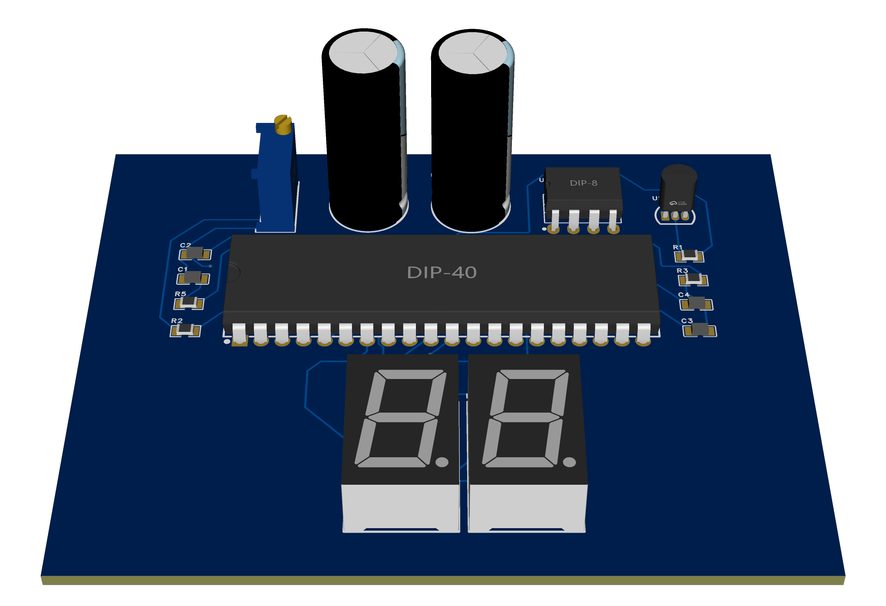

# LM35 + ICL7107 Digital Thermometer

A two-digit Celsius thermometer designed for IE2044 System Modeling and Prototyping at the Sri Lanka Institute of Information Technology (SLIIT). The circuit uses an LM35 analog temperature sensor and an ICL7107 integrating ADC to drive two seven-segment LEDs without firmware.

*EasyEDA design render. The project reached simulation, PCB layout and breadboard testing. The breadboard readings were unstable, and PCB fabrication and validation remain open.*

## Design at a glance

| Parameter | Design |
| --- | --- |
| Intended display range | 00–99 °C in 1 °C display increments |
| Sensor | Through-hole LM35, nominal output of 10 mV/°C |
| ADC and display driver | ICL7107, DIP-40 |
| Display | Two seven-segment LED digits driven from the ADC tens and hundreds outputs |
| Analog input scaling | 10 kΩ series resistor and 1.105 kΩ resistor to ground |
| ADC reference target | 100 mV differential, set with a potentiometer |
| Power | ±5 V nominal for the ADC. The EasyEDA schematic uses an ICL7660 to generate the negative rail. |
| Design tools | Proteus for simulation and EasyEDA for schematic and PCB layout |

## How the display scaling works

1. The LM35 produces approximately 10 mV/°C. At 30 °C its nominal output is 300 mV.
2. The divider shown in the Proteus and EasyEDA schematics passes about 9.95% of the sensor output to the ADC. At 30 °C, the ADC input is therefore about 29.9 mV.
3. The ICL7107 dual-slope ADC produces approximately `1000 × VIN / VREF` raw counts, where both voltages are differential. With a nominal 100 mV reference, the 30 °C example gives about 299 raw counts, close to the ideal 300.
4. The displays use the hundreds and tens outputs. With ideal scaling, a raw reading of 0300 appears as `30`. Because the nominal divider is slightly below 0.1 and the units digit is omitted, check digit transitions at the actual reference setting and resistor values. An ADC reading of 0299 would appear as `29`.

The 1 °C display increment is a design target. Hardware accuracy and repeatability remain to be measured.

## Evidence and project files

| Stage | Evidence | What it shows |
| --- | --- | --- |
| Proteus simulation | [0 °C → 00](hardware/proteus/evidenceproteus-0c.png) · [30 °C → 30](hardware/proteus/evidenceproteus-30c.png) | Two visible test cases. The report also lists 25, 50 and 75 °C. |
| EasyEDA PCB layout | [2D routing](hardware/easyeda/pcb-2d-routing.png) · [3D perspective](hardware/easyeda/pcb-3d-perspective.png) · [3D top](hardware/easyeda/pcb-3d-top.png) | Board routing, component placement and display alignment. |
| Breadboard | [Project report](docs/IE2044_Assignment_Group_06.pdf), sections 5.4–5.8 | The circuit powered up, but the report records fluctuations of about ±2 to ±5 displayed counts and sensitivity to touch. |
| Assembled PCB | Pending | The assignment called for a working PCB-mounted circuit. Fabrication and bench validation remain outstanding. |

The [project report](docs/IE2044_Assignment_Group_06.pdf) includes the complete schematic in Figure 2 and a breadboard photo in Figure 5.

## Reproducing and validating the design

1. **Recover the design sources.** Add the native Proteus project and required models, the editable EasyEDA schematic and PCB files, and a BOM with part numbers, footprints and quantities.
2. **Check scaling in Proteus.** Measure the LM35 output, differential ADC input and differential reference at 0, 25, 30, 50, 75 and 99 °C. Sweep around a digit transition and log the two displayed digits. Check behavior outside the two-digit range if the sensor can encounter those temperatures.
3. **Isolate the breadboard instability.** Measure both supply rails, the reference and the ADC input while the display fluctuates. Repeat with a stable test voltage in place of the sensor and, if available, a clean external negative rail in place of the charge pump. These checks can help distinguish input noise, reference drift and supply ripple.
4. **Verify before fabrication.** Check schematic connectivity, run a fresh ERC/DRC and inspect the Gerber and drill exports. After assembly, compare readings with a reference thermometer at multiple points and record display error and short-term variation.

See the [Proteus notes](hardware/proteus/README.md) and [EasyEDA notes](hardware/easyeda/README.md) for the files available at each stage.

## References and credits

- [Texas Instruments LM35 datasheet](https://www.ti.com/lit/ds/symlink/lm35.pdf)
- [Renesas ICL7106/ICL7107 datasheet](https://www.renesas.com/en/document/dst/icl7106-icl7107-icl7107s-datasheet)

**Group 06** · Lahinth M. and Viyashan K. · IE2044 System Modeling and Prototyping · SLIIT

No open-source license has been specified.
